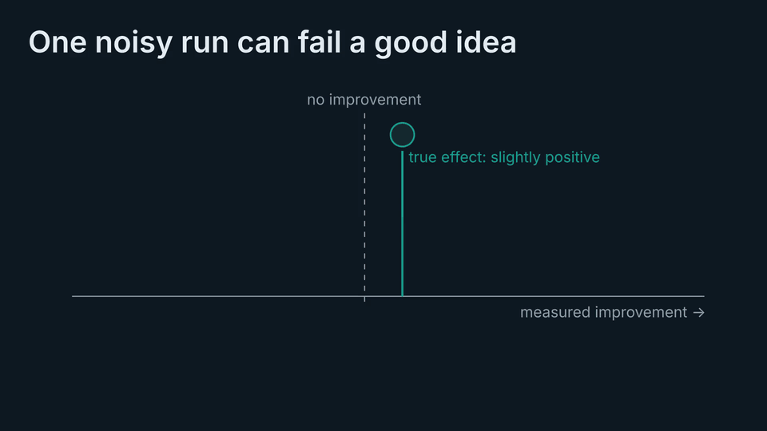

# Wrongful Convictions in Shared Failure Banks — code and data

Code: Yingjie Bai. Papers: Yingjie Bai and Weiming Zhi, School of Computer Science, The University of Sydney.

<p align="center">
  <a href="media/overview.mp4"></a>
  <br><sub><b><a href="media/overview.mp4">Watch the 4-minute narrated overview</a></b> (with sound; English subtitles in <a href="media/overview.srt">overview.srt</a>). The animation above is a silent excerpt.</sub>
</p>

Autonomous research systems increasingly share *negative knowledge*: failed attempts go into a common
bank so no agent repeats them. Failure verdicts come from noisy, small-*n* experiments, and a bank that
stores them as irreversible binary `DEAD` records locks genuinely good ideas away for good. Under
success-gated idea supply, where confirmed ideas generate the next proposals, this costs whole
lineages of discoveries. Evidence-graded records with a reopening path (`OPEN` / `CLOSED`) avoid it.

This repository holds the code, raw logs and cached runs behind two NeurIPS 2026 workshop papers:

- **The Optimal Memory of Failure Is Lossy: Wrongful Convictions in Shared Failure Banks for Autonomous Research.**
  NeurIPS 2026 Workshop on AI for Science (Verification in the Age of AI Scientists).
  [OpenReview](https://openreview.net/forum?id=ZSUCDw8SSy)
- **The Memory of Failure Should Be Lossy: Wrongful Convictions in Shared Failure Banks for Autonomous Research.**
  NeurIPS 2026 Workshop: Who Verifies the Agents? Toward Reliable Agent Development.

Raw per-call model outputs, verdict logs and training-run caches are included, so every analysis
reproduces without calling a model or retraining anything.

## What is where

| Topic | Directory | What it reproduces |
|---|---|---|
| Simulations | `simulation/` | inverted-U in deference, existence conditions, design-rule comparison, horizon losses |
| Wrongful-conviction rates, live loop | `replay_chargpt/` | char-GPT training-loop verdicts vs. 16-seed ground truth; W_A, W_B, leave-one-out, cluster bootstrap |
| Second live domain | `replay_mlp/` | MLP/digits replay, measurement-aware W_A |
| Independent-seed replication | `wb_replication/` | 1,070-config verification-stage study (near-miss convictions) |
| Public benchmark | `fcnet/` | 122,817-conviction FCNet replay and conviction-vs-effect curve |
| LLM behavior | `behavioral/` | DEAD vs. INCONCLUSIVE label studies, 12 models / 9 families, chemistry domain, fresh-run replication |
| LLM proposer in the loop | `inloop/` | DeepSeek proposer with the bank in its prompt; soft and code-enforced locks |
| Second proposer family | `e6/` | GPT-4o in the enforced gated cell |
| End-to-end closed loop | `sysloop/` | algorithmic proposer, five memory rules, 8 replicates; volume-matched parole control; threshold sweep; truth-label sensitivity |
| Low-noise control cell | `e2e_lownoise/` | independent implementation where binary locking edges thresholding |
| Audit of a deployed bank | `audit/`, `insitu_fix/` | audit of the public Negative_Knowledge bank, a calibrated-status fix experiment, and a code-level survey of eight agent systems |
| Proposed record format | `spec/FAILURE_RECORD_SPEC.md` | evidence-bearing failure record: fields and rules |
| Figures | `figures/` | figure generators |
| Overview video | `media/` | narrated animation of both papers, generated from code (Manim scenes, synthesized narration and music); see `media/README.md` |

Preregistrations sit next to the experiments they cover (`PREREG_*.md`). They are shipped as frozen
before data collection; results and deviations were appended afterwards and are marked as such.

## Quick checks (no API calls, no training)

Run each from inside its directory. Python 3.10+, `numpy`, `scipy`, `scikit-learn`, `matplotlib`.

```bash
cd sysloop && python3 truth_sensitivity.py results   # end-to-end: graded 60.5 vs binary 46.6, and under stricter truth criteria
cd inloop  && python3 e5_analysis.py                  # DeepSeek, enforced lock: graded 18.2 vs binary 15.2, p = 0.021
cd e6      && python3 e6_analysis.py                  # GPT-4o, enforced lock: graded 12.2 vs binary 13.4
cd audit   && python3 kappa.py                        # clean-limit constants for verification-stage convictions
```

`sysloop/sysloop.py`, `sysloop_p3.py` and `sysloop_theta.py` replay the closed-loop experiments from
`results/cache.jsonl`; a run only trains models for (config, seed) pairs missing from the cache.
Experiments that call LLM APIs need your own provider keys; see each runner's header.

## Third-party material

`audit/` and `insitu_fix/` analyse the public
[Negative_Knowledge](https://github.com/hch-wang/Negative_Knowledge) repository (MIT License) by its
authors. `insitu_fix/results/` contains prompts derived from that repository's saved stage-2 cells,
with one added status line per record; the original content is theirs. FCNet benchmark data is not
redistributed; the header of `fcnet/fcnet_replay.py` gives the download command.

## Citation

```bibtex
@inproceedings{bai2026optimal,
  title     = {The Optimal Memory of Failure Is Lossy: Wrongful Convictions in Shared Failure Banks for Autonomous Research},
  author    = {Bai, Yingjie and Zhi, Weiming},
  booktitle = {NeurIPS 2026 Workshop on AI for Science: Verification in the Age of AI Scientists},
  year      = {2026},
  url       = {https://openreview.net/forum?id=ZSUCDw8SSy}
}

@inproceedings{bai2026memory,
  title     = {The Memory of Failure Should Be Lossy: Wrongful Convictions in Shared Failure Banks for Autonomous Research},
  author    = {Bai, Yingjie and Zhi, Weiming},
  booktitle = {NeurIPS 2026 Workshop: Who Verifies the Agents? Toward Reliable Agent Development},
  year      = {2026}
}
```

## License

MIT; see `LICENSE`.
